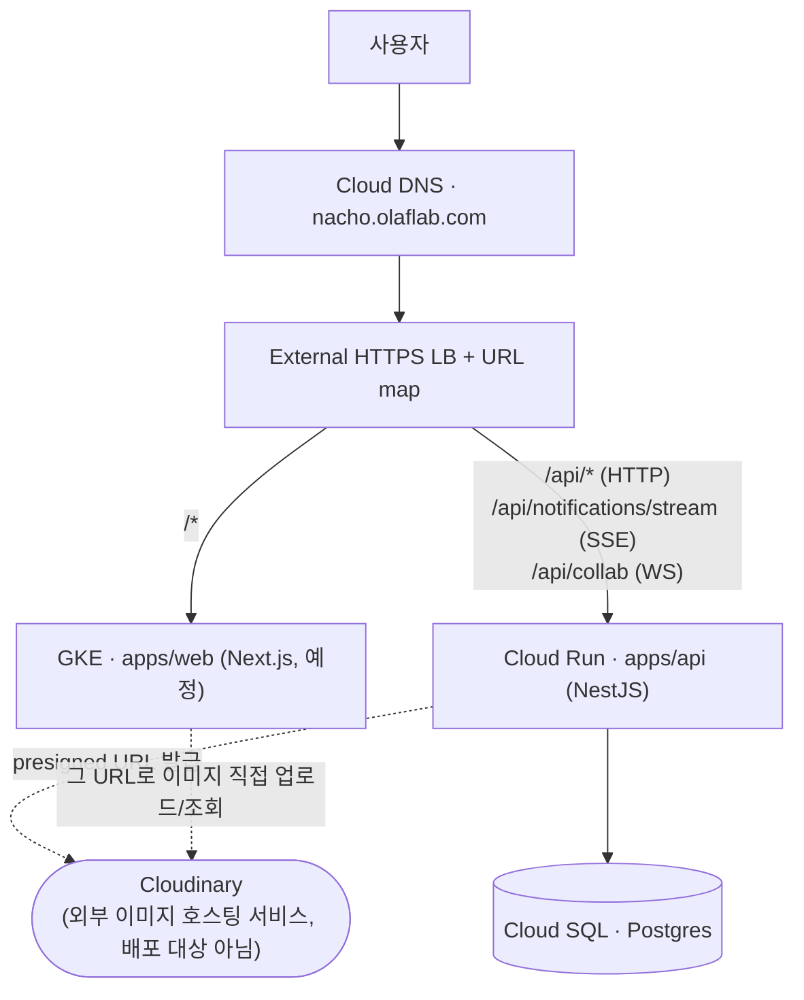

# 🎄 nacho — 친구랑 만드는 나만의 초대장

소셜 로그인 → 방 만들기 → 친구 초대(방장 승인) → 방 안에서 초대장 여러 개를 **실시간 동시 편집** → 이미지로 저장.
설계 논의는 [GitHub Discussions](https://github.com/blackpeachcake/nacho/discussions) 참고 (#4 기능, #6 BE, #7 인프라, #8 구조).

## 기능

구현 순서/스펙은 [`specs/`](specs/)에 `NNN-기능명` 단위로 정리돼 있다 (spec → plan → tasks).

| 스펙                                                               | 기능                                   |
| ------------------------------------------------------------------ | -------------------------------------- |
| [001](specs/001-kakao-signup)                                      | 카카오 소셜 로그인 / 회원가입          |
| [002](specs/002-room)                                              | 방(Room) 만들기                        |
| [003](specs/003-auth-session)                                      | 인증 세션 (쿠키 기반)                  |
| [004](specs/004-join-request)                                      | 방 초대 & 가입 승인                    |
| [005](specs/005-notifications), [012](specs/012-notifications-sse) | 알림 조회·읽음 처리 / 실시간 전달(SSE) |
| [006](specs/006-invitation)                                        | 초대장(Invitation) 생성·관리           |
| [007](specs/007-account-deletion)                                  | 회원 탈퇴                              |
| [008](specs/008-room-leave-delete)                                 | 방 나가기 · 방 삭제                    |
| [009](specs/009-profile-update)                                    | 프로필 수정                            |
| [010](specs/010-upload-signature)                                  | Cloudinary presigned 업로드            |
| [013](specs/013-collab-editor)                                     | 초대장 실시간 공동편집 (Yjs + WS)      |

## 구조

### 모노레포

```
nacho/
├─ apps/
│  ├─ web/          # FE — Next.js 16 (App Router), Dockerfile 포함
│  └─ api/          # BE — NestJS + Prisma
├─ packages/
│  └─ shared/       # FE/BE 공유 TypeScript 타입
├─ specs/           # 기능별 spec.md / plan.md / tasks.md (SDD)
├─ docker-compose.yml  # 로컬 dev DB(Postgres)
├─ .github/         # CI(PR 검사), BE 배포(Cloud Run), PR 자동 담당자·리뷰어 지정, PR 템플릿
├─ lefthook.yml     # Git 훅 (prettier·eslint / commitlint / typecheck·test)
└─ tsconfig.base.json
```

### 배포 인프라

한 도메인(`nacho.olaflab.com`)을 External HTTPS LB가 경로로 분기하는 하이브리드 구조. **BE(Cloud Run)는 배포됨**, **FE(GKE)는 예정**(FE팀 담당). 자세한 내용은 [#7 인프라 설계 디스커션](https://github.com/blackpeachcake/nacho/discussions/7) 참고.



같은 도메인 경로(`/api/*`)로 묶여 있어 **same-origin**이라 CORS가 필요 없고, 인증 쿠키도 호스트 하나만 바라보면 된다. Cloudinary는 인프라에 배포하는 게 아니라, 초대장 이미지를 저장·제공하는 외부 SaaS를 BE가 presigned URL로 중개하는 것([010](specs/010-upload-signature)).

### 실시간 통신 (SSE / WebSocket)

- **SSE** `GET /api/notifications/stream` — 알림을 서버 → 클라이언트 단방향으로 실시간 전달 ([012](specs/012-notifications-sse)).
- **WebSocket** `WS /api/collab` — Yjs(CRDT) + Hocuspocus로 초대장 여러 명이 동시 편집 ([013](specs/013-collab-editor)). 인증은 커스텀 헤더를 못 보내는 SSE/WS 특성상 **쿠키 기반**으로 처리. 연결·인증·동기화 세부 플로우는 [`specs/013-collab-editor/spec.md`](specs/013-collab-editor/spec.md#22-연동-플로우-연결-1번-기준)의 시퀀스 다이어그램 참고.

## 시작하기

```bash
nvm use            # Node 22
corepack enable    # pnpm (package.json의 packageManager 버전)
pnpm install       # lefthook 훅도 자동 설치

docker compose up -d                      # 로컬 DB (Postgres, localhost:5433)
cp apps/api/.env.example apps/api/.env    # DB/JWT/카카오/Cloudinary 값 채우기
pnpm --filter api exec prisma db push
pnpm dev:api                              # http://localhost:3000

cp apps/web/.env.example apps/web/.env    # NEXT_PUBLIC_API_URL 등
pnpm dev:web                              # http://localhost:5173
```

- `apps/api/.env`의 `DATABASE_URL`은 위 `docker-compose.yml` 기준 기본값으로 맞춰져 있어 그대로 두면 된다.
- `JWT_*_SECRET`은 로컬 전용이라 임의 문자열이면 충분하다.
- 카카오 로그인·업로드까지 실제로 테스트하려면 `KAKAO_REST_API_KEY` / `KAKAO_CLIENT_SECRET` / `CLOUDINARY_*`를 BE 담당자에게 받아 채워야 한다. FE 화면 작업만 할 때는 비워둬도 서버는 뜬다.

휴대폰에서 FE 개발 서버 열기: `DEV_ALLOWED_ORIGINS=<PC의 IP> pnpm dev:web` 후 `http://<PC의 IP>:5173`.

## 스크립트

| 명령                                         | 내용                                        |
| -------------------------------------------- | ------------------------------------------- |
| `pnpm dev:web` / `pnpm dev:api`              | 웹(5173) / API(3000) 개발 서버              |
| `pnpm build:web`                             | 웹 프로덕션 빌드                            |
| `pnpm lint` · `pnpm typecheck` · `pnpm test` | 전체 워크스페이스 검사                      |
| `pnpm format` · `pnpm format:check`          | Prettier                                    |
| `pnpm --filter web test:e2e`                 | Playwright E2E (Pixel 7 / iPhone 15 뷰포트) |
| `pnpm --filter api db:push` / `db:migrate`   | Prisma 스키마 반영 / 마이그레이션           |

## 배포

- **FE**: `docker build -f apps/web/Dockerfile --build-arg NEXT_PUBLIC_API_URL=... .` (컨텍스트는 루트)
- **BE**: `.github/workflows/deploy-api.yml` — main 푸시 시 Cloud Run(`nacho-api`, asia-northeast3)으로 자동 배포

인프라 설계는 [#7 인프라 설계 디스커션](https://github.com/blackpeachcake/nacho/discussions/7) 참고.
