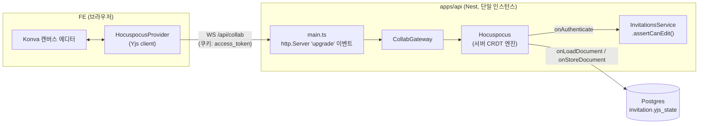
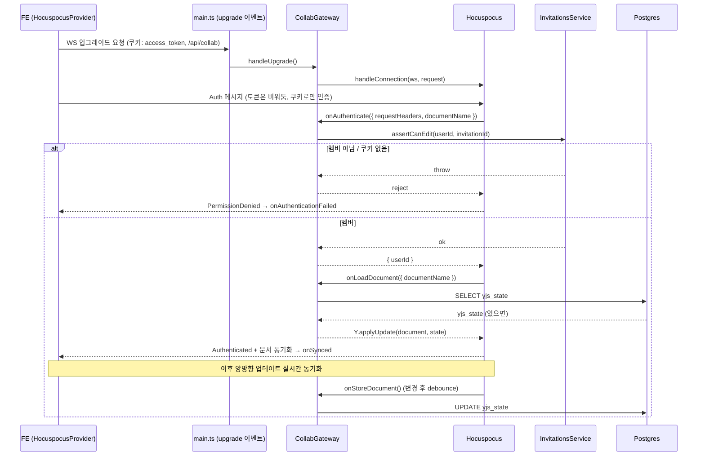

# 013 — 초대장 실시간 공동편집 (WS, BE)

상태: **구현 완료(로컬 검증 끝, 배포 전)** · 출처: 세션 중 사용자 요청("FE 에디터 코드 추가했어 웹소켓 구조 잡아줘") · [#6 BE 설계 확정](https://github.com/blackpeachcake/nacho/discussions/6#discussioncomment-19861439)의 `WS /collab` 항목 구현

## 1. 무엇을 / 왜

FE에 캔버스 에디터(Konva + Yjs, 로컬 전용 프로토타입)가 추가됐다. 이제 **여러 사용자가 같은 초대장을 동시에 편집**할 수 있도록 **Yjs + Hocuspocus** 기반 WS 서버를 붙인다. `invitation.yjs_state`(006에서 추가, 미사용 컬럼)에 CRDT 상태를 저장한다.

## 2. 범위 (이 스펙)

- BE만. `WS /api/collab` 하나.
  - **경로가 `/api` 하위인 이유**: `access_token` 쿠키가 `path=/api`로 스코프돼 있어, `/collab`(루트)로 두면 업그레이드 요청에 쿠키가 안 붙는다. `#6`에서 `WS /collab`로 적었던 걸 쿠키 스코프에 맞춰 `/api/collab`로 조정. 기존 인그레스 규칙(`/api/*` → API)도 그대로 재사용 가능해 인프라 변경이 없다.
- 문서 단위 = 초대장 1개 = Y.Doc 1개, documentName = `invitation:<id>`.
- 인증: WS 업그레이드 요청에 자동으로 붙는 `access_token` 쿠키를 읽어 검증(커스텀 헤더를 못 보내는 `EventSource`와 달리 WS는 핸드셰이크가 일반 HTTP 요청이라 쿠키가 그대로 실림. `token` 옵션은 쓰지 않음).
- 인가: 해당 초대장이 속한 방의 멤버(owner 포함)만 연결 가능 — 기존 `InvitationsService`의 멤버 체크 로직 재사용.
- 영속화: `onLoadDocument`에서 `invitation.yjs_state` 복원, `onStoreDocument`(라이브러리 기본 debounce)에서 저장.
- Cloud Run 요청 타임아웃을 300s → 3600s로 늘림(WS 연결이 5분 만에 끊기는 것 방지). `deploy-api.yml`의 `gcloud run deploy`에 `--timeout` 추가.

## 2.1 구조

## 2.2 연동 플로우 (연결 1번 기준)

## 3. 수용 기준 (Acceptance Criteria)

- [x] 쿠키 없이 WS 업그레이드 시도 → 거부(연결 안 됨)
- [x] 쿠키는 있지만 그 초대장이 속한 방의 멤버가 아니면 → 거부
- [x] 멤버면 연결되고, `invitation.yjs_state`가 있으면 복원된 상태로 동기화됨
- [x] 문서가 변경되고 일정 시간 후 `invitation.yjs_state`에 반영됨
- [x] 두 클라이언트가 같은 초대장에 연결하면 한쪽 변경이 다른 쪽에도 전달됨(Hocuspocus 기본 동작 — 수동 확인)

## 4. 범위 밖 (나중)

- **멀티 인스턴스 환경에서의 동기화** — 지금은 단일 Hocuspocus 인스턴스의 인메모리 Y.Doc. Cloud Run이 여러 인스턴스로 스케일아웃되면 인스턴스마다 문서 상태가 분리됨. 트래픽 늘면 `@hocuspocus/extension-redis` 또는 sticky session 필요(#6에 이미 명시된 미결정 항목).
- FE `HocuspocusProvider` 연동(라우팅에 초대장 id 반영, `useEditorDoc`에 provider 추가) — FE 담당.
- awareness(커서/누가 편집 중인지 표시) UI — 라이브러리가 기본 지원하지만 이번 스펙은 서버 쪽 통과만 다룸.
- 방/초대장 삭제 시 편집 중인 연결 강제 종료 — #6에 언급됐으나 이번 스펙은 다루지 않음.
